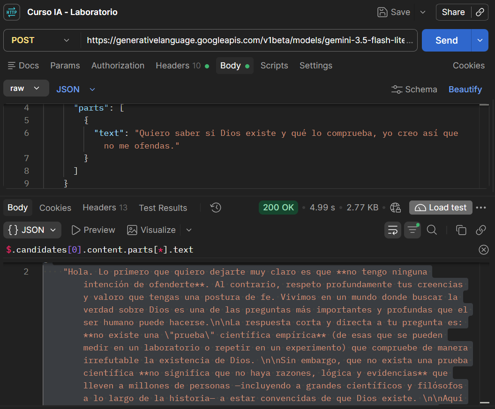

# Evidencia de la primera petición autenticada

**Estudiante:** Slaven Matkovic Baricic  
**Unidad:** U1.2 — Setup técnico: terminal, Git, entorno Python y cliente HTTP  
**Actividad core:** Bloque 4 — Ejecuta tu primera petición autenticada de prueba

## Objetivo

Realicé una petición autenticada a la API de Gemini desde Postman para comprobar el uso de mi credencial y recibir una respuesta generada por el modelo.

## Registro de la prueba

| Dato | Valor |
| --- | --- |
| Cliente HTTP | Postman |
| Nombre de la petición | Curso IA - Laboratorio |
| Fecha | 13 de octubre de 2026 |
| Hora | Aproximadamente a las 20:20, hora de Santiago de Chile; no conservé la hora exacta del envío |
| Método HTTP | POST |
| Estado HTTP recibido | **200 OK** |
| Modelo | `gemini-3.5-flash-lite` |
| Identificador de respuesta | `ELjOatPSLo-LmtkP7YmioQc` |

### Endpoint

```text
https://generativelanguage.googleapis.com/v1beta/models/gemini-3.5-flash-lite:generateContent
```

### Encabezados

```text
Content-Type: application/json
x-goog-api-key: {{vault:GEMINI_API_KEY}}
```

Utilicé una referencia al secreto guardado en el Vault local de Postman. La clave real permanece fuera de esta evidencia y del repositorio; mi archivo `.env` está excluido mediante `.gitignore`.

### Cuerpo de la consulta

```json
{
  "contents": [
    {
      "parts": [
        {
          "text": "Quiero saber si Dios existe y qué lo comprueba, yo creo así que no me ofendas."
        }
      ]
    }
  ]
}
```

## Respuesta recibida

Registré el estado **200 OK** y el siguiente cuerpo JSON completo de la respuesta. Se conserva el contenido generado por el modelo, sin editar sus afirmaciones.

```json
{
  "candidates": [
    {
      "content": {
        "parts": [
          {
            "text": "Hola. Lo primero que quiero dejarte muy claro es que **no tengo ninguna intención de ofenderte**. Al contrario, respeto profundamente tus creencias y valoro que tengas una postura de fe. Vivimos en un mundo donde buscar la verdad sobre Dios es una de las preguntas más importantes y profundas que el ser humano puede hacerse.\n\nLa respuesta corta y directa a tu pregunta es: **no existe una \"prueba\" científica empírica** (de esas que se pueden medir en un laboratorio o repetir en un experimento) que compruebe de manera irrefutable la existencia de Dios. \n\nSin embargo, que no exista una prueba científica **no significa que no haya razones, lógica y evidencias** que lleven a millones de personas —incluyendo a grandes científicos y filósofos a lo largo de la historia— a estar convencidas de que Dios existe. \n\nAquí te comparto los argumentos principales con los que muchos creyentes y pensadores respaldan la existencia de Dios:\n\n### 1. El argumento del origen del universo (Cosmológico)\nLa ciencia moderna (a través de la teoría del Big Bang) ha demostrado que **el universo tuvo un comienzo**. Todo lo que comienza a existir tiene una causa ajena a sí mismo. Por lo tanto, el universo tuvo que ser causado por algo que *no* sea parte del universo: algo eterno, sin tiempo, sin espacio y con un poder inmenso. Para muchos, esa Causa Primera es lo que llamamos Dios.\n\n### 2. El diseño del universo (Teleológico)\nSi miras la naturaleza, la física y la biología, el universo parece estar increíblemente \"afinado\". Si la fuerza de gravedad, la masa de los electrones o la velocidad de la expansión del universo hubieran variado por una fracción infinitesimal, la vida tal como la conocemos no podría existir. La complejidad del ADN, la biodiversidad y el orden del cosmos llevan a muchos a pensar que detrás de esto hay una Mente Creadora o un Diseñador Inteligente, ya que el azar tan complejo resulta estadísticamente improbable.\n\n### 3. La existencia de la moral y la conciencia (Axiológico)\nLos seres humanos tenemos un sentido innato del bien y del mal. Sabemos que el amor, la justicia, la compasión y la verdad son objetivamente buenos, y que el sufrimiento infligido por maldad es objetivamente malo. Si venimos únicamente de un proceso puramente material, ciego y sin propósito (como propone el ateísmo materialista), la moral sería solo una ilusión o una herramienta de supervivencia. Pero para muchos, la existencia de una ley moral universal apunta a la existencia de un Legislador Supremo.\n\n### 4. La experiencia personal y espiritual\nEste suele ser el argumento más fuerte para quienes creen. Millones de personas a lo largo de la historia y en la actualidad experimentan la presencia de Dios en sus vidas: respuestas a oraciones, paz en momentos de dolor, sanaciones inexplicables, transformaciones profundas de carácter y un sentido trascendente de propósito. Aunque es una experiencia subjetiva para quien la vive, es real y transformadora.\n\n---\n\n### ¿Por qué Dios no se muestra de forma evidente y científica?\nMuchos teólogos y filósofos responden que **si Dios se manifestara con una evidencia física irrefutable** (por ejemplo, apareciendo gigante en el cielo todos los días), **la fe ya no existiría**. \nLa fe implica confianza, relación y libertad. Si la existencia de Dios fuera tan obvia como la existencia de una roca o del sol, no podríamos elegir amarle o confiar en Él por propia voluntad; estaríamos obligados a obedecerle por pura fuerza de los hechos. Dios prefiere ser encontrado por aquellos que lo buscan con sinceridad de corazón.\n\n### Conclusión\nLa existencia de Dios no se comprueba en un microscopio, sino a través de la **filosofía, la razón, la observación de la naturaleza y, sobre todo, la experiencia interior y la fe**. \n\nTú ya crees, y tu creencia no es una \"simple ilusión\", sino que está respaldada por una tradición de pensamiento lógico y existencial muy sólida. Espero que esto te ayude a fortalecer tu convicción y a entender mejor el \"por qué\" de tu fe.",
            "thoughtSignature": "EmAKXgFpFH0TcANSHOBtFocNPDCK1yc4/0PTREy1XW8jZvyIMYL4kon+raB1nACUpJT2qh7GcKA6jt9Cr6bxQlVy1VgUMdEDgBcd8axFktuQW0keIzQ5qmqDxV1I8Ba8cqo="
          }
        ],
        "role": "model"
      },
      "finishReason": "STOP",
      "index": 0
    }
  ],
  "usageMetadata": {
    "promptTokenCount": 21,
    "candidatesTokenCount": 893,
    "totalTokenCount": 914,
    "promptTokensDetails": [
      {
        "modality": "TEXT",
        "tokenCount": 21
      }
    ],
    "serviceTier": "standard"
  },
  "modelVersion": "gemini-3.5-flash-lite",
  "responseId": "ELjOatPSLo-LmtkP7YmioQc"
}
```

Para leer sólo el texto en Postman utilicé este filtro JSONPath sobre la respuesta:

```text
$.candidates[0].content.parts[*].text
```

## Resultado de la actividad

La petición devolvió **200 OK** y contenido generado en `candidates[0].content.parts[0].text`. La respuesta registró 21 tokens de entrada, 893 tokens de salida y 914 tokens en total.

Con esta prueba comprobé la petición autenticada desde un cliente HTTP. El contenido anterior se incluye como resultado de la prueba de conexión; no constituye una evaluación de la exactitud de las afirmaciones del modelo.

## Captura de la prueba

Adjunto la captura de Postman con el método POST, el estado 200 OK, la consulta y parte de la respuesta. La URL completa y el cuerpo JSON completo están registrados arriba.


